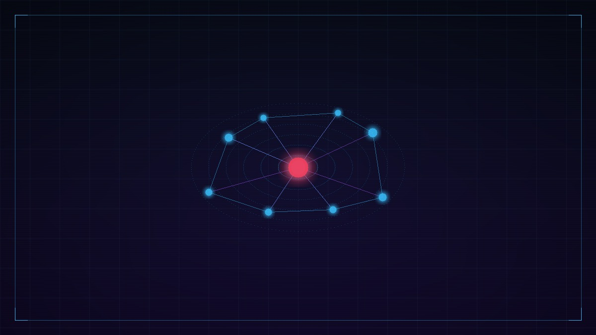
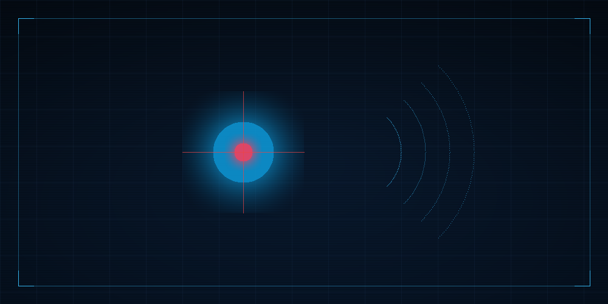
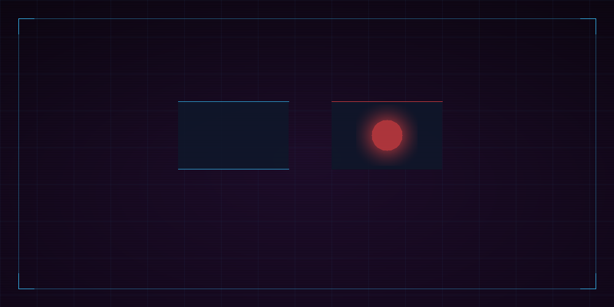
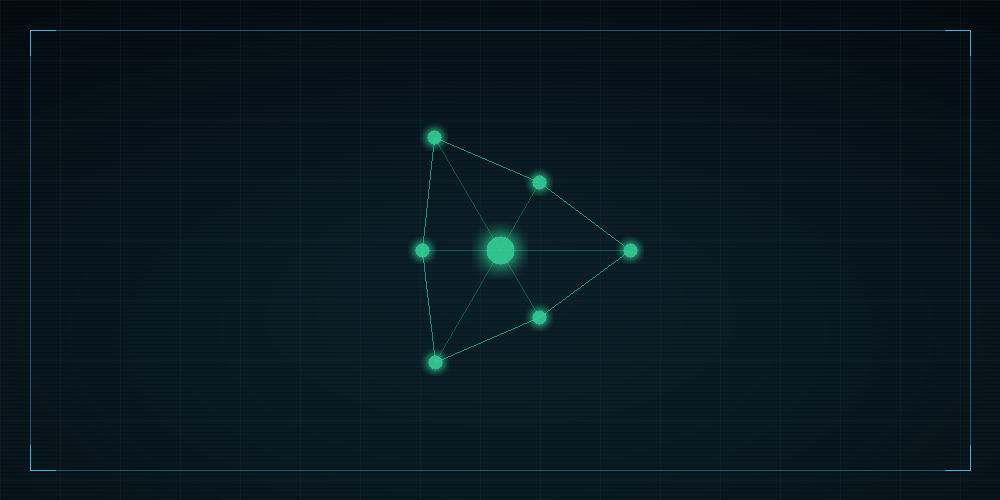

{fig-align="center" width="100%"}

## 1. 도입 (Introduction)

> **"만약 누군가 옷 단추에 숨겨진 보이지 않는 카메라로 시험지를 비추고, 귓속 초소형 이어폰으로 AI가 속삭이는 정답을 들으며 시험을 치른다면, 우리는 과연 그것을 적발할 수 있을까요?"**

과거의 '커닝'이 손바닥이나 책상 밑에 깨알같이 적은 메모를 몰래 훔쳐보는 원시적인 형태였다면, 오늘날의 부정행위는 **생성형 AI(ChatGPT, Gemini, Claude 등)와 첨단 초소형 IoT 하드웨어**가 결합된 고도의 지능형 기술 범죄로 급격히 진화했습니다.

최근 국가전문자격시험부터 유수 대학들의 중간·기말고사 현장까지, AI를 악용한 부정행위가 연이어 수면 위로 드러나며 교육계와 사회 전반에 거대한 충격을 안겨주고 있습니다. 과연 기술의 눈부신 발전은 인류가 수 세기 동안 신뢰해 온 '시험'이라는 제도의 존립 자체를 뒤흔들고 있는 것일까요?

---

## 2. 핵심 요약 (Key Takeaways)

AI 시험 부정행위의 현재 실태와 향후 파장을 관통하는 3가지 핵심 쟁점은 다음과 같습니다.

1. **상상을 초월하는 기술적 은밀화**: 단순한 웹 검색 수준을 넘어 초소형 위장 카메라, 무선 인이어(In-ear) 이어폰, 개조 계산기 등 하드웨어와 결합하여 육안 감독 체계를 무력화하고 있습니다.
2. **사후 추적 및 차단의 한계**: 해외 빅테크 서버를 통한 실시간 프롬프트 처리와 사생활 보호 법률 등으로 인해, 시험 주관 기관이 실시간으로 부정행위를 탐지하거나 데이터를 확보하기 어렵습니다.
3. **평가 패러다임의 전면적 전환 불가피**: 단순 암기식 및 정답 도출형 지필고사는 더 이상 공정성을 담보할 수 없으며, 비판적 사고력과 문제 해결 과정을 검증하는 '과정 중심 평가'로의 혁신이 요구됩니다.

---

## 3. 상세 설명 (In-depth Analysis)

### 3.1 첨단 하드웨어와 생성형 AI의 결합: 은밀해진 수법들

{fig-align="center" width="90%"}

최근 치러진 **제63회 세무사 2차 시험에서 수석 합격자가 AI를 이용한 부정행위를 자수한 사건**은 공공시험 관리 체계에 큰 경종을 울렸습니다. 

* **초소형 카메라 위장**: 안경테, 수정테이프 케이스, 셔츠 단추 등에 마이크로 렌즈를 숨겨 시험지 문제를 고화질로 촬영합니다.
* **무선 데이터 전송 및 AI 풀이**: 촬영된 이미지는 외부 테더링 모듈을 통해 조력자 또는 생성형 AI 분석 파이프라인으로 전송됩니다.
* **비가시적 정답 수신**: 육안으로는 식별하기 어려운 고막형 자석 이어폰이나 특수 편광 필름으로 개조한 공학용 계산기 화면을 통해 정답을 실시간 수신했습니다.

해외에서도 튀르키예 대입 시험(YKS)에서 신발 밑창에 초소형 라우터를 숨기고 단추 카메라로 실시간 챗GPT 대리 풀이를 시도하던 수험생이 현장에서 체포되는 등, 10만~20만 원이면 손쉽게 구할 수 있는 스파이 장비들이 AI와 융합되며 전 세계적인 문제가 되고 있습니다.

### 3.2 비대면·온라인 시험의 감시망을 뚫는 '사각지대' 공략

{fig-align="center" width="90%"}

대학가의 온라인 시험 환경에서도 AI 치팅은 교묘한 형태로 이루어지고 있습니다.

* **화각 사각지대 활용**: 웹캠과 화면 공유 감시 프로그램을 가동하더라도 카메라 시야각 밖 모니터나 태블릿을 배치해 챗GPT에 프롬프트를 입력합니다.
* **협업형 AI 치팅방 운영**: 디스코드나 텔레그램 비밀 대화방을 개설하여 시험 문제를 실시간 공유하고, 집단 지성과 프롬프트 엔지니어링을 결합해 최적의 답변을 생성·공유합니다.
* **AI 감독관(AI Proctoring)의 한계**: 안면 인식과 시선 추적 AI 솔루션이 도입되고 있으나, 딥페이크 가상 카메라 소프트웨어 우회, 사생활 침해 논란, 잦은 오탐(False Positive)으로 인해 완전한 해결책이 되지 못하고 있습니다.

### 3.3 처벌 강화와 법제화의 현주소

사법 당국은 이러한 행위를 단순 학칙 위반이 아닌 **'위계에 의한 공무집행방해죄'** 및 **'업무방해죄'**를 적용하여 무관용 원칙으로 강력 대응하고 있습니다. 

그러나 근본적인 난제가 남아 있습니다. 주요 생성형 AI 서비스(OpenAI, 구글, 앤트로픽 등)가 해외에 본사를 두고 있어, 국내 수사기관이나 주관처가 시험 시간대의 질의 기록을 실시간으로 확보하는 데 엄격한 해외 통신보호법과 개인정보 규제라는 장벽이 존재합니다.

---

## 4. 마무리 및 전망 (Conclusion & Future Outlook)

{fig-align="center" width="90%"}

AI를 이용한 부정행위의 증가는 단순히 '부정행위 기술의 발달'만을 의미하지 않습니다. 이는 지난 세기 동안 사회적 신뢰를 유지해 온 **'정답 맞히기식 상대평가'라는 체계 자체가 기술적 한계점에 도달했음**을 선언하는 구조적 전환점입니다.

앞으로의 교육과 평가는 다음과 같은 방향으로 패러다임이 전면 재편될 것입니다.

1. **'오픈 AI' 환경의 공식화**: AI 사용을 원천 금지하는 대신, 시험 중 AI 도구를 공식적으로 허용하되 AI가 내놓은 답안의 오류를 분석하고 비판적으로 재구성하는 역량을 평가.
2. **과정 중심 평가(Process-oriented Assessment)**: 단 한 번의 시험 결과가 아니라, 포트폴리오 구축 과정과 논리 전개 과정을 단계별로 검증.
3. **구술 시험 및 심층 토론 결합**: 작성된 결과물에 대해 1:1 대면 인터뷰와 질의응답을 통해 학생의 실제 이해도와 독창적 사고력을 직접 확인.

> 기술은 이미 인간의 지식 암기 능력을 아득히 추월했습니다. 이제 시험과 평가가 증명해야 할 진정한 가치는 기계가 결코 흉내 낼 수 없는 **인간 고유의 비판적 통찰과 문제 해결력, 그리고 윤리적 분별력**입니다.

---

## 5. 참고 자료 (References)

* [성균관대학교 교육개발센터 보고서: AI 시대 대학 평가 혁신과 부정행위 방지 대책](https://www.skku.edu)
* [동아일보: 세무사 시험 수석 합격자 초소형 카메라·챗GPT 부정행위 적발 사건](https://www.donga.com)
* [YTN 뉴스 리포트: 단추 카메라와 신발 밑창 라우터… 진화하는 첨단 커닝 수법](https://www.ytn.co.kr)
* [조선일보: 생성형 AI 시험 부정행위 차단을 위한 글로벌 빅테크 데이터 협력 과제](https://www.chosun.com)
* [이코리안뉴스: 국가전문자격시험 첨단 전자기기 반입 통제 및 전파탐지기 도입 현황](https://www.ekoreanews.co.kr)
